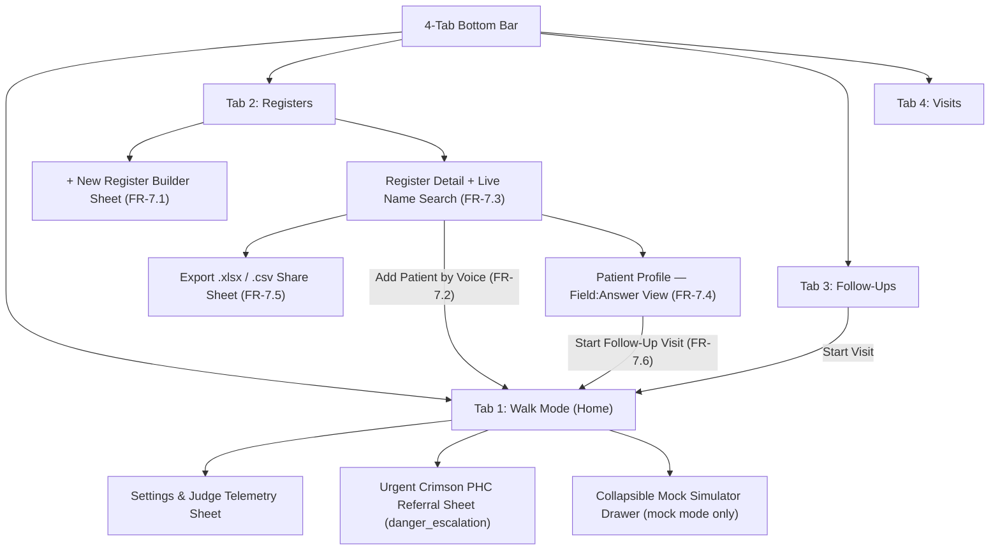

# UI/UX Design & Experience Specification — Phase P2
## ASHA Vaani — Native Android Client (Kotlin + Jetpack Compose Material 3)

**Target Users**: Rural Indian ASHA workers conducting house-to-house maternal (ANC), newborn (HBNC), and immunisation visits outdoors in direct sunlight and household/street noise.  
**Secondary Evaluators**: Gnani Voice Hackathon Judges evaluating sub-800ms TTFA, sub-150ms barge-in, Indian name/number accuracy, zero-typing UX, and strict zero-diagnosis safety compliance.

---

## 1. Core UX Philosophy ("Sunlit One-Thumb Walk Mode")

1. **Zero-Typing Primary Loop**: Every house visit (`capture → read-back → voice correction → confirm → save → follow-up scheduled`) and custom-register onboarding (`FR-7.2`) completes 100% by voice with a single thumb tap to start/stop hands-free listening.
2. **Direct Sunlight Legibility (WCAG AAA+)**: Soft drop shadows and faint grays disappear outdoors. Every card uses a crisp **`1.5dp` slate border (`#CBD5E1`)** on a pure white surface (`#FFFFFF`) over a cool off-white canvas (`#F8FAFC`), with `#0F172A` primary ink (`17.4:1` contrast ratio).
3. **One-Thumb Ergonomics**: All high-frequency controls (4-tab bottom navigation bar, giant `80dp` Mic Orb, Reset & Simulator buttons, primary sheet CTAs) live inside the lower 45% natural thumb arc. Every interactive target is **≥ `48dp × 48dp`** (`56dp` height for primary CTAs).
4. **Glanceable Voice State Machine**: An ASHA walking between houses never wonders whether the app is listening, speaking, updating a field, or escalating an emergency.
5. **No In-App Spreadsheet Grids**: Custom register patient profiles (`FR-7.4`) render exclusively as clean vertical **`Field : Answer`** rows — never horizontal-scrolling Excel tables. Spreadsheets are reserved strictly for 1-tap `.xlsx` / `.csv` export via Android `FileProvider`.

---

## 2. Design System Tokens (Material 3 `Theme.kt`)

### 2.1 Color Palette (Outdoor Daylight High-Contrast)

| Token Role | Name | Hex | Surface Tint / Border | Usage |
| :--- | :--- | :--- | :--- | :--- |
| `primary` | Deep Clinical Teal | `#0F766E` | `#CCFBF1` / `#99F6E4` | Primary CTAs, active nav pill, listening rings, brand mark |
| `background` | Sunlit Canvas | `#F8FAFC` | — | Screen background canvas |
| `surface` | Crisp White | `#FFFFFF` | Border `#CBD5E1` (`1.5dp`) | All structured form, register, patient, and visit cards |
| `onSurface` | Deep Slate Ink | `#0F172A` | Secondary `#334155`, Muted `#64748B` | High-contrast labels & clinical values |
| `voiceDiff` | Warm Amber | `#D97706` | Fill `#FEF3C7` / Border `#D97706` (`2dp`) | Animated `FieldDiff` voice-correction highlight (`3.2 → 2.8 kg`) |
| `error` / `danger` | Urgent Crimson | `#DC2626` | Fill `#FEF2F2` / Border `#FCA5A5` | Danger-sign PHC Referral Modal Sheet & flagged records |
| `success` | Verified Emerald | `#059669` | Fill `#ECFDF5` / Border `#A7F3D0` | Confirmed saves, Room sync status, Call/WhatsApp share |

### 2.2 Typography & Numeric Scale

* **Indic + Latin Readability**: System Roboto paired with Android's native Noto Sans Devanagari / Kannada / Tamil / Telugu fallback (zero missing glyphs across all 4 Indic languages).
* **Screen Title**: `18sp ExtraBold` (`#0F172A`)
* **Card Hero / Patient Name**: `16sp–18sp ExtraBold` (`#0F172A`)
* **Clinical Value (`2.8 kg`, `30 goli`, `O+`)**: `16sp–18sp ExtraBold` with `fontFeatureSettings = "tnum"` (tabular numbers so live diff updates never jitter horizontally)
* **Field Label (`WEIGHT`, `BLOOD GROUP`)**: `11sp Bold` uppercase, `0.05em` letter spacing (`#64748B`)
* **Spoken Transcript & Read-Back**: `14sp–15sp Medium/SemiBold` (`lineHeight = 20sp`)

### 2.3 Shape, Spacing & Haptics

* **Corner Radii**: Cards `16dp`, Modal Bottom Sheets `26dp` top corners, Pills/Chips `999dp`, Primary Buttons `16dp`.
* **Haptic Feedback (`HapticFeedbackType` / `VibrationEffect`)**:
  * **Mic Start / Stop**: Crisp light click (`EFFECT_CLICK`).
  * **Voice Correction (`FieldDiff`)**: Short double-tick confirming field updated.
  * **Record Saved (`visit_saved` / `patient_saved`)**: Positive confirmation buzz.
  * **Danger Escalation (`danger_escalation`)**: Distinct heavy alert pulse (`EFFECT_HEAVY_CLICK` × 2) synchronized with the Crimson PHC Referral Sheet.

---

## 3. Navigation Architecture & End-to-End User Flows

---

## 4. Screen-by-Screen UX Blueprint

### 4.1 Walk Mode Screen (`WalkModeScreen.kt`) — Default Home Tab
Designed as a single glanceable column with zero clutter:
1. **Top App Bar**:
   * Left: Brand glyph + `ASHA Vaani` + mode subtitle (`Walk Mode · Hands-Free` or `Voice Intake · FR-7.2`).
   * Right: Compact **Judge Telemetry & Status Pill** (e.g., `● 28ms · MOCK` or `● 410ms · LIVE`). Tapping opens the **Settings & Speech Telemetry Sheet**.
2. **1-Tap Native Language Pill Row**:
   * Horizontal chips showing native scripts only: `हिन्दी` | `ಕನ್ನಡ` | `தமிழ்` | `తెలుగు` | `Auto`.
   * Active pill fills solid `#0F766E` with white bold text; tapping emits `{"type": "language_change", "language_code": "..."}`.
3. **Contextual Mode Banner (Conditional)**:
   * **FR-7.6 Follow-Up Baseline Banner** (Emerald tint): Shown when launched from a patient profile (`Sunita Devi · Age 24 · Blood Group B+`) with a `Clear` chip.
   * **FR-7.2 Custom Register Intake Banner** (Teal tint): Shown when onboarding a new patient by voice into a named register (`ANC First Intake Register`) with a `Back to Visits` chip.
4. **Live Structured Form Card**:
   * **Visit Mode**: Beneficiary Name + Status Pill (`READY` / `AWAITING READ-BACK` / `PHC ESCALATED`), crisp 2-column grid for `Visit Type`, `Weight (kg)`, `IFA Tablets`, `Next Visit Date`, plus full-width `Vaccinations Due` badge row.
   * **Register Intake Mode (FR-7.2)**: Patient Name + dynamic vertical `Field : Answer` rows for all `expected_fields`.
   * **Animated Amber `FieldDiff`**: When a voice correction arrives (`weight_kg: 3.2 → 2.8`), that specific tile transitions to `#FEF3C7` fill + `2dp #D97706` border with a `VOICE FIX` badge and strikethrough old value (`3.2 → 2.8 kg`) for high visibility in sunlight.
5. **Live Transcript & Read-Back Strip**:
   * Top line (`YOU SPOKE`): Italic gray partial STT streaming live → solid dark ink final transcript.
   * Bottom line (`AGENT READ-BACK`): Agent's localized read-back prompt + animated 4-bar waveform indicator labeled **"Speak to interrupt"** while Timbre v3.0 audio is playing (visually communicating `< 150ms` barge-in).
6. **Collapsible Mock Simulator Drawer (Mock Mode Only)**:
   * Hidden when `gnani_mode == "live"`. In `mock` mode, a compact `Sim` button beside the mic toggles 1-tap demo chips (`ANC Visit`, `Fix Weight → 2.8`, `Haan Save`, `Newborn Fever!`) plus a free-text utterance input (`text_turn`).
7. **One-Thumb Mic Control Dock (Pinned Bottom)**:
   * Left (`48dp`): `Reset` button (`reset_draft`).
   * Center (`80dp`): Giant Teal Mic Orb (switches to Crimson Stop square while active) surrounded by concentric **live 16kHz PCM RMS pulse rings**.
   * Right (`48dp`): `Sim` drawer toggle (in mock mode) or `Manual Save` fallback.

### 4.2 Urgent Red PHC Referral Modal Sheet (`PhcReferralSheet.kt`)
Triggered automatically on `danger_escalation` WebSocket event:
* **Crimson Header (`#DC2626`)**: `IMMEDIATE EMERGENCY` pill + canonical NHM code (`DS_NB_HIGH_FEVER_COLD`) + bold headline `"Refer to PHC Immediately"` + patient name & canonical symptom.
* **Spoken Instruction Card**: Displays the exact localized referral message spoken by Timbre v3.0.
* **Strict PS1 Compliance Shield**: Explicitly displays `Canonical NHM List Only · Zero Diagnosis / No Medicine Advice` so judges verify Pillar #3 visually as well as audibly.
* **Action Stack (56dp tall buttons)**:
  1. **Call 108 / PHC Now** (Solid Crimson `#DC2626`) → launches `Intent.ACTION_DIAL` (safe, zero `CALL_PHONE` permission friction).
  2. **Share Referral via WhatsApp / SMS** (Emerald `#059669`) → launches `Intent.ACTION_SEND` with pre-formatted beneficiary name, flagged symptom, timestamp, and PHC referral note.
  3. **Confirm Record Flagged & Close** (Neutral Slate).

### 4.3 Settings & Speech Telemetry Sheet (`SettingsSheet.kt`)
Opened by tapping the top-right TTFA pill:
* **Latency Breakdown Grid**: 4-tile readout (`TTFA`, `ASR`, `LLM`, `Barge-In`) color-coded emerald when `< 800ms`.
* **Hardware Audio Layer Verification**: Live badges reflecting actual Android DSP attachment (`✓ AEC Active`, `✓ NoiseSuppressor`, `✓ AGC`, `16kHz PCM · 20ms`).
* **Editable Backend Server URL**: Defaults to `http://127.0.0.1:8000` (USB `adb reverse`), editable for LAN Wi-Fi/tunnel demos, with `Save & Reconnect`.
* **Editable PHC / 108 Helpline Number**: Persisted locally for `ACTION_DIAL`.

### 4.4 Custom Registers Tab (`RegistersScreen`, `RegisterDetailScreen`, `PatientProfileScreen`)
1. **Registers List**: High-contrast cards displaying register name, category tag, patient count, and custom field chips + bottom-right **`+ New Register`** extended FAB.
2. **`+ New Register` Sheet**: Name, description, 1-tap toggleable clinical preset chips (`Age`, `Blood Group`, `LMP`, `Parity`, `Medical History`, `Phone`, `House / Ward`), plus custom field name & type (`TEXT` | `NUMBER` | `DATE` | `BOOLEAN`) creator.
3. **Register Detail**:
   * Sticky instant name search bar (`FR-7.3`) querying `/api/registers/{id}/patients?q=` with Room DB offline fallback.
   * Clean patient cards (initials avatar, name, ID, 3-field summary snippet).
   * Top-bar **`Export .xlsx / .csv`** button (`FR-7.5`) opening the Export Sheet → native Android `FileProvider` share sheet.
   * Prominent bottom-right **`Add Patient by Voice`** extended FAB (`FR-7.2`) sending `register_select` and switching directly to Walk Mode.
4. **Patient Profile (`Field : Answer` View — FR-7.4)**:
   * Deep Teal hero header with patient initials, name, ID, and category.
   * Crisp vertical **`Field : Answer`** card stack with clear uppercase labels on the left and bold readable answers on the right (**zero spreadsheet grid**).
   * Pinned bottom primary CTA: **`Start Follow-Up Visit by Voice`** (`FR-7.6`) sending `patient_select` and launching Walk Mode with baseline pre-loaded + secondary `Edit` icon button.

### 4.5 Follow-Ups & Visits Tabs (`FollowUpScreen.kt`, `VisitsScreen.kt`)
* **Follow-Ups**: Filter chips (`All` | `PHC Urgent` | `Pending` | `Completed`). Escalated PHC referrals pin to top with crimson borders (`#DC2626`). Each pending card offers 1-tap **`✓ Mark Done`** and **`🎙 Start Visit`**.
* **Visits**: Filter chips (`All Visits` | `PHC Escalated Only`). Each card displays beneficiary name, visit type badge, timestamp, crimson flagged danger banner (when `has_danger_sign == true`), and a compact 3-column summary (`Weight`, `IFA`, `Next Visit`).

---

## 5. Voice & Error Resilience States

| State / Edge Case | Visual Experience |
| :--- | :--- |
| **Offline / Backend Disconnected** | Top-right status pill turns Amber (`OFFLINE · CACHE`). Registers, Patient Profiles, Follow-Ups, and Visits remain 100% readable from Room DB. Walk Mode shows a clear reconnect button. |
| **Noisy Street / Baby Crying** | Server-side VAD rejects noise cleanly; mic orb stays steady without false form triggers. |
| **Barge-In During Read-Back** | Tapping or speaking immediately cuts `AudioTrack` (`flushImmediately()`), stops the waveform animation, and highlights the new partial transcript. |
| **Multi-House Isolation** | Confirming save shows a brief emerald toast (`Saved · Ready for next house`), clears the visit card and any FR-7.6 baseline banner, and resets cleanly for the next household. |
